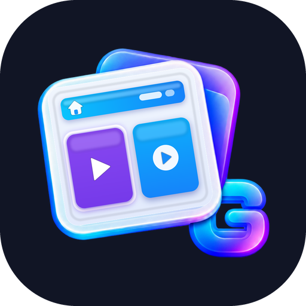

 <a href="CHANGELOG.md">Deutsch</a> &nbsp;·&nbsp;  <b>English</b>

# Changelog

**Everything new in Gimbo Launcher, latest version first.**

[Download](../../releases/latest) · [README](README.en.md)

## 1.16.0

- New app icon, also as the tile in the Fire OS app row

## 1.15.4

- After switching on, the launcher no longer jumps to the front while an app is already running
- New setting: go to the first tile after Home

## 1.15.3

- New versions show up sooner: checked right after every update and then every 3 hours

## 1.15.2

- Banner in the Fire TV menu shows up again

## 1.15.1

- Updates show up clearly as a colored button at the top right

## 1.15.0

- Continue watching for Jellyfin, Plex, Emby and Kodi, each source as its own row
- New "Recently used" row with apps like Netflix, Disney+ or Prime Video
- Rows can be reordered and switched off; with several rows the home screen scrolls down

## 1.14.3

- New banner in the Fire TV menu, matching the launcher

## 1.14.2

- Starts faster: Fire OS compiles the launcher ahead of time in standby after every update

## 1.14.1

- Continue watching: first entry no longer cut off after switching on
- Tiles and cards stay fully visible while scrolling

## 1.14.0

- Updates right in the launcher: automatic or manual, with what's new before installing
- Trademark notice in the licenses in every language

## 1.13.0

- New language: Russian
- Wind labels and units in every language

## 1.12.0

- New languages: French, Spanish, Italian, Portuguese, Dutch, Polish, Japanese
- Word clock and date in every language
- Language picker as its own list in the settings

## 1.11.1

- Home button: Apps button always shown, no more getting stuck top right
- Continue watching shows new titles up front right away
- Weather in the location's time, place search in the app language
- Expired Jellyfin sign-in is reported

## 1.11.0

- First release
- Clock, weather and apps as tiles on one page
- Continue watching from your own Jellyfin server
- German and English
