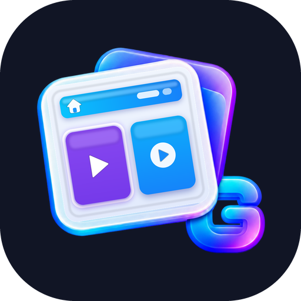

🇩🇪 <b>Deutsch</b> &nbsp;·&nbsp; 🇬🇧 <a href="CHANGELOG.en.md">English</a>

# Änderungen

**Alle Neuerungen im Gimbo Launcher, die neueste Version zuerst.**

[Download](../../releases/latest) · [README](README.md)

## 1.16.0

- Neues App-Icon, auch als Kachel in der App-Reihe von Fire OS

## 1.15.4

- Nach dem Einschalten holt sich der Launcher nicht mehr nach vorne, wenn schon eine App läuft
- Neue Einstellung: nach Home zur ersten Kachel

## 1.15.3

- Neue Versionen erscheinen schneller: Prüfung nach jedem Update sofort und danach alle 3 Stunden

## 1.15.2

- Banner im Fire-TV-Menü wird wieder angezeigt

## 1.15.1

- Updates sind oben rechts als farbiger Knopf deutlich sichtbar

## 1.15.0

- Weiterschauen für Jellyfin, Plex, Emby und Kodi, jede Quelle als eigene Reihe
- Neue Reihe „Zuletzt genutzt“ mit Apps wie Netflix, Disney+ oder Prime Video
- Reihen sortierbar und einzeln abschaltbar, die Startseite scrollt bei mehreren Reihen nach unten

## 1.14.3

- Neuer Banner im Fire-TV-Menü, passend zum Launcher

## 1.14.2

- Startet schneller: Fire OS kompiliert den Launcher nach jedem Update im Standby von selbst vorab

## 1.14.1

- Weiterschauen: erster Eintrag nach dem Einschalten nicht mehr abgeschnitten
- Kacheln und Karten bleiben beim Blättern ganz sichtbar

## 1.14.0

- Updates direkt im Launcher: automatisch oder von Hand, mit Neuerungen vor der Installation
- Markenhinweis in den Lizenzen in jeder Sprache

## 1.13.0

- Neue Sprache: Russisch
- Windangaben und Einheiten in jeder Sprache

## 1.12.0

- Neue Sprachen: Französisch, Spanisch, Italienisch, Portugiesisch, Niederländisch, Polnisch, Japanisch
- Wortuhr und Datum in jeder Sprache
- Sprachauswahl als eigene Liste in den Einstellungen

## 1.11.1

- Home-Taste: Übersicht-Knopf immer da, kein Festhängen oben rechts
- Weiterschauen zeigt neue Titel sofort vorne
- Wetter in der Zeit des Orts, Ortssuche in der App-Sprache
- Abgelaufene Jellyfin-Anmeldung wird gemeldet

## 1.11.0

- Erste Veröffentlichung
- Uhr, Wetter und Apps als Kacheln auf einer Seite
- Weiterschauen vom eigenen Jellyfin-Server
- Deutsch und Englisch
