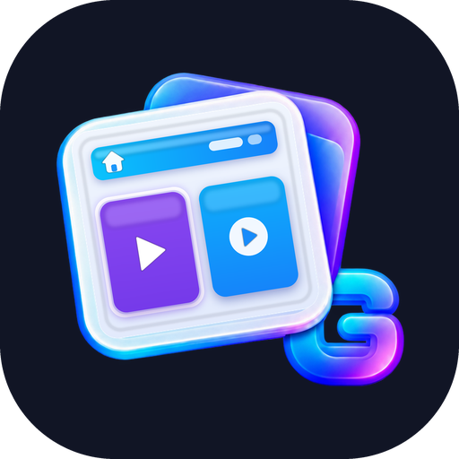
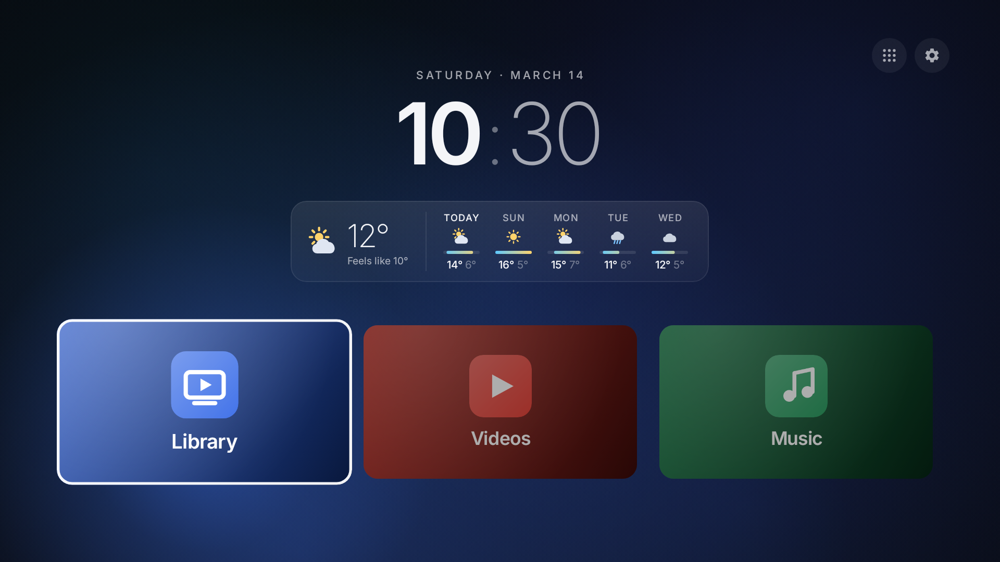
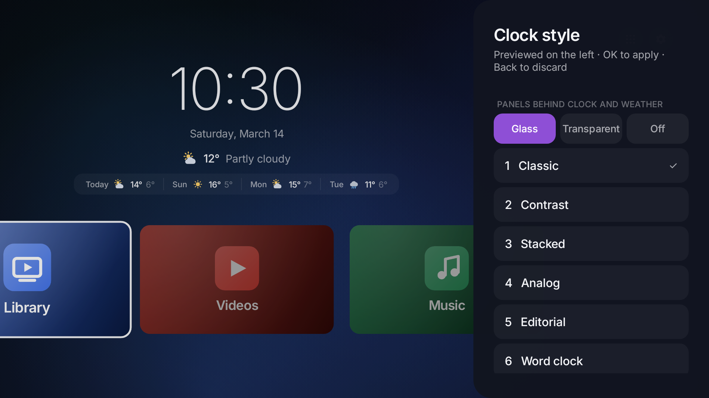
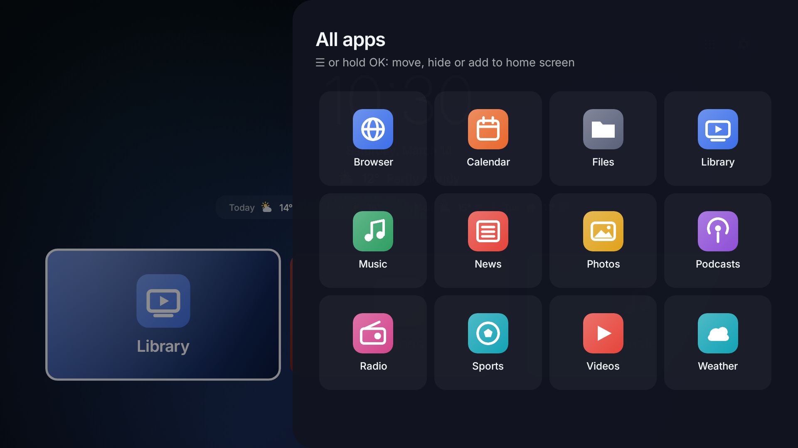
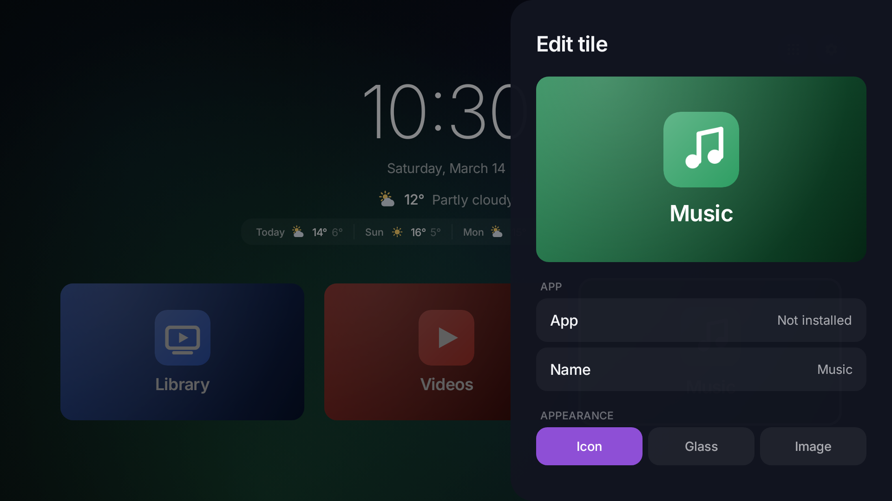
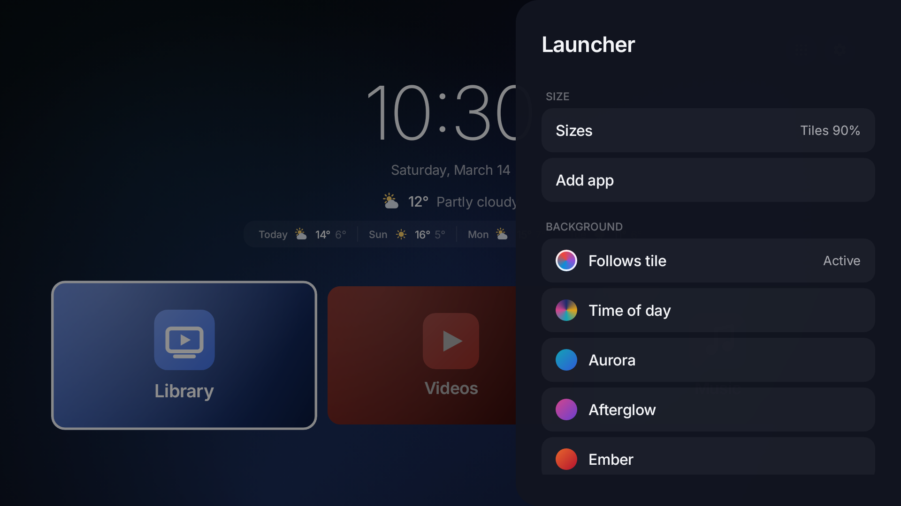
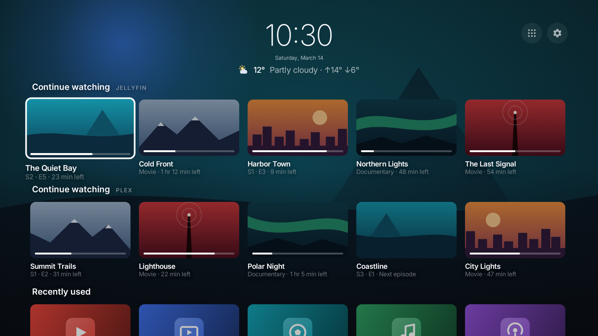

<div align="center">

 <a href="README.md">Deutsch</a> &nbsp;·&nbsp;  <b>English</b>



# Gimbo Launcher

**A calm home screen for Fire TV: clock, weather and your apps as tiles.**

[Download](../../releases/latest) · [Setup](#setup) · [Features](#features) · [Languages](#languages) · [Changelog](CHANGELOG.en.md)

</div>



## Setup

Download `Gimbo-Launcher-vX.Y.Z.apk` from [Releases](../../releases/latest) and install it once via ADB
(on the Fire TV, turn on *Developer options › ADB debugging*):

```sh
adb connect <fire-tv-ip>
adb install -r Gimbo-Launcher-vX.Y.Z.apk
adb shell pm grant dev.hiarni.gimbo.launcher android.permission.READ_LOGS
adb shell appops set dev.hiarni.gimbo.launcher SYSTEM_ALERT_WINDOW allow
adb shell appops set dev.hiarni.gimbo.launcher REQUEST_INSTALL_PACKAGES allow
adb shell am force-stop dev.hiarni.gimbo.launcher
```

After that, the Home button opens Gimbo Launcher. Fire OS does not allow third-party launchers, so the app detects
when the Amazon home screen starts and immediately covers it.

**Updates** are fetched by the launcher itself: every few hours and right after each update it looks for a new version on GitHub, and "Update"
appears at the top right. One click shows what's new, downloads and installs it; Fire OS asks once for
confirmation, then the launcher restarts. Manually: Gear › Info › Updates. Settings and tiles are kept.
`adb install -r` followed by `am force-stop` still works too.

> Fire TV with Fire OS only. Devices running Vega OS cannot install APKs.

**Optional, for more speed:** The launcher ships with a startup profile, so after every installation Fire OS compiles
it ahead of time by itself once the Fire TV is in standby. The first command does this right away. The other three
halve the system animations of the whole Fire TV (use `1` instead of `0.5` to restore the default).

```sh
adb shell cmd package compile -m speed -f dev.hiarni.gimbo.launcher
adb shell settings put global window_animation_scale 0.5
adb shell settings put global transition_animation_scale 0.5
adb shell settings put global animator_duration_scale 0.5
```

## Features

| | |
|---|---|
| **Tiles** | Any app, with name, color and style per tile (Gimbo, Banner, Icon, Glass, own image) |
| **Clock & weather** | 15 clock and 17 weather styles, freely combinable, with hourly forecast and up to 7 days |
| **Everything at a glance** | Clock, weather and tiles always fit on one screen and scale smoothly |
| **All apps** | Every installed app, custom order, hide apps |
| **Continue watching** | Separate rows for Jellyfin, Plex, Emby and Kodi, plus "Recently used" with apps like Netflix or Disney+; sortable and individually switchable |
| **Ambient mode** | After a while without input, only clock and weather remain |
| **Backup** | All settings including your own images as a file in the Download folder |
| **Updates** | New versions right from the app, checked automatically or by hand |
| **10 languages** | All texts, date and word clock in the chosen language, see [Languages](#languages) |

Controls: **☰** or **long-press OK** opens a tile's menu, the gear opens the settings.

<table>
<tr>
<td width="50%"></td>
<td width="50%"></td>
</tr>
<tr>
<td width="50%"></td>
<td width="50%"></td>
</tr>
</table>

## Continue watching



Every source gets its own row below the tiles, titled "Continue watching" with the source shown small next to it. With two or more rows the home
screen slides up as you scroll down, clock and weather shrink, and you can browse the rows from top to bottom. Set it up
under Gear › Continue watching; that's also where you reorder and switch off rows.

| Source | Setup | Opens |
|---|---|---|
| **Jellyfin** | Server is found on your home network, sign-in via Quick Connect or password (Jellyfin 10.8 or later) | the title directly in the Jellyfin app |
| **Plex** | Enter the code at [plex.tv/link](https://plex.tv/link), the server is picked automatically | the Plex app |
| **Emby** | Server is found on your home network, sign-in with username and password | the Emby app |
| **Kodi** | In Kodi allow *Settings › Services › Control › Allow remote control via HTTP*, then enter address and port (usually `127.0.0.1:8080`) | Kodi and resumes playback |
| **Recently used** | Once: `adb shell appops set dev.hiarni.gimbo.launcher GET_USAGE_STATS allow` | the app, for example Netflix, Disney+ or Prime Video |

Netflix, Disney+ and Prime Video don't offer an open interface for their "Continue watching". "Recently used" therefore
shows the apps themselves; one click opens them with their own continue-watching list. The Kodi list updates while Kodi
is running in the background; otherwise the launcher shows the last known state.

## Languages

Deutsch · English · Français · Español · Italiano · Português · Nederlands · Polski · Русский · 日本語

Switch under Gear › System › Language. With "System" the launcher follows the Fire TV language; if that one isn't
included, English is shown. The translations are JSON files in
[`app/src/main/resources/i18n`](app/src/main/resources/i18n), improvements are welcome. If a text is missing there,
the app shows the English version.

## Privacy

No account, no ads, no tracking. Data only leaves the Fire TV for:

- **Weather:** the coordinates of the chosen location are sent to [Open-Meteo](https://open-meteo.com/); place search sends the name you type and the app language.
- **Continue watching:** connections only to your own servers (Jellyfin, Emby, Kodi). For Plex also to plex.tv for
  sign-in and the server list. Only access tokens and the last loaded list are stored locally. Usage statistics for
  "Recently used" are only read on the Fire TV.
- **Updates:** the latest version is looked up on GitHub and the APK is downloaded from there. Can be turned off
  under Gear › Info › Check for updates automatically.

The system log (`READ_LOGS`) is only read to detect when the Amazon home screen starts and is neither stored nor
transmitted. Backups stay as a file in the Download folder.

## Build

```sh
./gradlew assembleRelease
```

Every push to `main` builds the APK and publishes it as a release.

## License

The code is licensed under the [MIT License](LICENSE). Bundled fonts and libraries have their own licenses, see
[third-party notices](THIRD_PARTY_NOTICES.md). Weather data by [Open-Meteo.com](https://open-meteo.com/)
([CC BY 4.0](https://creativecommons.org/licenses/by/4.0/)).

Amazon, Fire TV, Fire OS and Prime Video are trademarks of Amazon.com, Inc. Jellyfin, Plex, Emby, Kodi, Netflix,
Disney+, SmartTube and other names belong to their respective owners. Gimbo Launcher is an independent project and is not affiliated with any of them.
