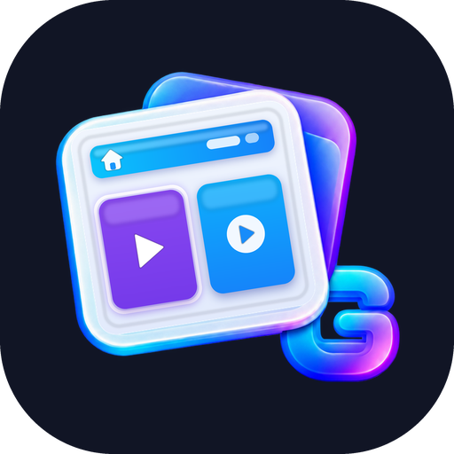
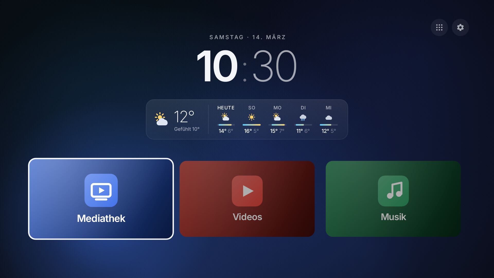
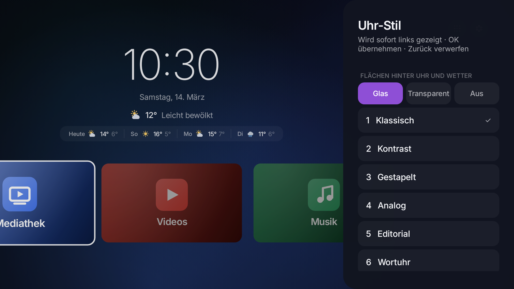
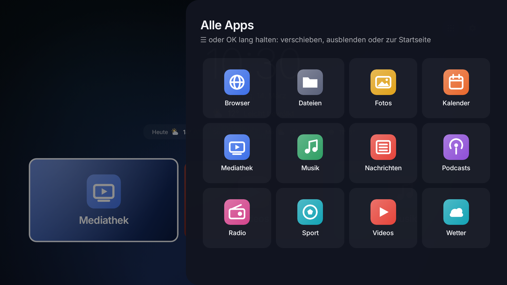
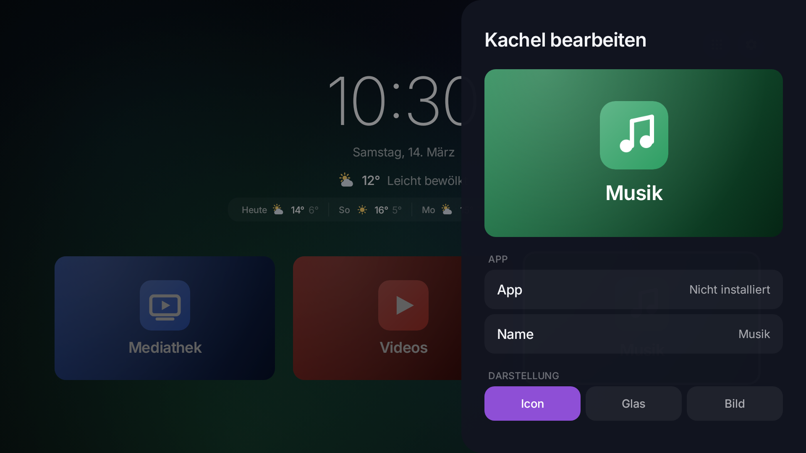
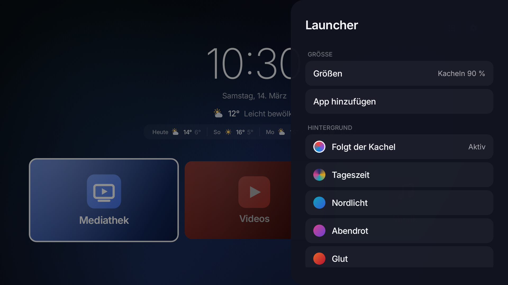
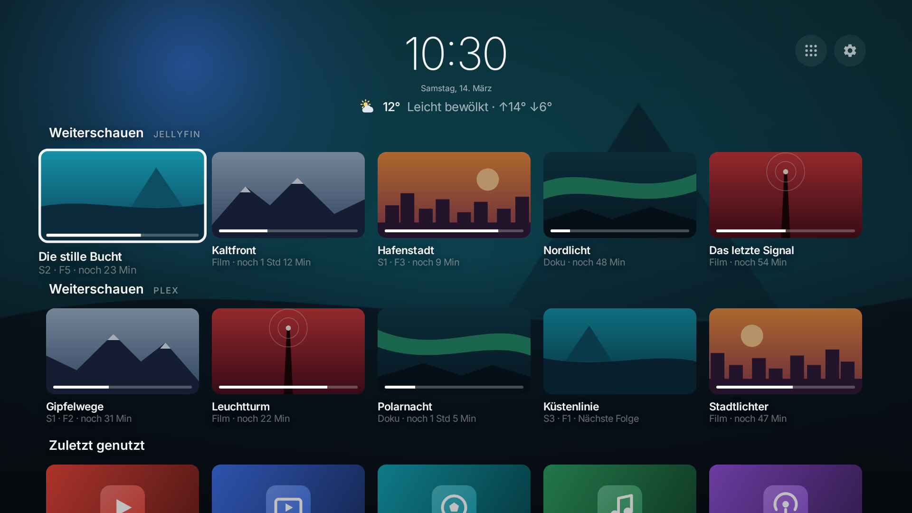

<div align="center">

 <b>Deutsch</b> &nbsp;·&nbsp;  <a href="README.en.md">English</a>



# Gimbo Launcher

**Ruhige Startseite für Fire TV: Uhr, Wetter und deine Apps als Kacheln.**

[Download](../../releases/latest) · [Einrichten](#einrichten) · [Funktionen](#funktionen) · [Sprachen](#sprachen) · [Änderungen](CHANGELOG.md)

</div>



## Einrichten

Unter [Releases](../../releases/latest) die Datei `Gimbo-Launcher-vX.Y.Z.apk` laden und einmalig per ADB installieren
(am Fire TV *Entwickleroptionen › ADB-Debugging* einschalten):

```sh
adb connect <IP-des-Fire-TV>
adb install -r Gimbo-Launcher-vX.Y.Z.apk
adb shell pm grant dev.hiarni.gimbo.launcher android.permission.READ_LOGS
adb shell appops set dev.hiarni.gimbo.launcher SYSTEM_ALERT_WINDOW allow
adb shell appops set dev.hiarni.gimbo.launcher REQUEST_INSTALL_PACKAGES allow
adb shell am force-stop dev.hiarni.gimbo.launcher
```

Danach öffnet die Home-Taste den Gimbo Launcher. Fire OS erlaubt keinen fremden Launcher, deshalb erkennt die App
den Start der Amazon-Startseite und legt sich sofort darüber.

**Updates** holt sich der Launcher selbst: Er sucht alle paar Stunden und direkt nach jedem Update bei GitHub nach einer neuen Version, oben rechts
erscheint dann „Update“. Ein Klick zeigt die Neuerungen, lädt und installiert sie; Fire OS fragt einmal zur
Bestätigung, danach startet der Launcher neu. Von Hand: Zahnrad › Info › Updates. Einstellungen und Kacheln bleiben
erhalten. Alternativ geht weiterhin `adb install -r` mit anschließendem `am force-stop`.

> Nur für Fire TV mit Fire OS. Geräte mit Vega OS können keine APKs installieren.

**Optional, für mehr Tempo:** Der Launcher bringt ein Startprofil mit, Fire OS kompiliert ihn damit nach jeder
Installation von selbst vorab, sobald der Fire TV im Standby ist. Der erste Befehl erledigt das sofort. Die drei weiteren
halbieren die System-Animationen des ganzen Fire TV (mit `1` statt `0.5` wieder Standard).

```sh
adb shell cmd package compile -m speed -f dev.hiarni.gimbo.launcher
adb shell settings put global window_animation_scale 0.5
adb shell settings put global transition_animation_scale 0.5
adb shell settings put global animator_duration_scale 0.5
```

## Funktionen

| | |
|---|---|
| **Kacheln** | Beliebige Apps, je Kachel Name, Farbe und Darstellung (Gimbo, Banner, Icon, Glas, eigenes Bild) |
| **Uhr & Wetter** | 15 Uhr- und 17 Wetter-Stile, frei kombinierbar, mit Stundenverlauf und bis zu 7 Tagen |
| **Alles auf einen Blick** | Uhr, Wetter und Kacheln passen immer auf eine Seite und sind stufenlos skalierbar |
| **Alle Apps** | Alle installierten Apps, eigene Reihenfolge, Apps ausblenden |
| **Weiterschauen** | Eigene Reihen für Jellyfin, Plex, Emby und Kodi, dazu „Zuletzt genutzt“ mit Apps wie Netflix oder Disney+; sortierbar und einzeln abschaltbar |
| **Ruhemodus** | Nach einer Weile ohne Eingabe nur noch Uhr und Wetter |
| **Sicherung** | Alle Einstellungen samt eigener Bilder als Datei im Download-Ordner |
| **Updates** | Neue Versionen direkt aus der App, automatisch gesucht oder von Hand |
| **10 Sprachen** | Alle Texte, Datum und Wortuhr in der gewählten Sprache, siehe [Sprachen](#sprachen) |

Bedienung: **☰** oder **OK lang** öffnet das Menü einer Kachel, das Zahnrad die Einstellungen.

<table>
<tr>
<td width="50%"></td>
<td width="50%"></td>
</tr>
<tr>
<td width="50%"></td>
<td width="50%"></td>
</tr>
</table>

## Weiterschauen



Jede Quelle bekommt eine eigene Reihe unter den Kacheln, mit „Weiterschauen“ und klein daneben der Quelle. Ab zwei Reihen gleitet die
Startseite beim Hinunterscrollen nach oben, Uhr und Wetter werden klein, und die Reihen lassen sich von oben nach unten
durchblättern. Einrichten unter Zahnrad › Weiterschauen; dort lassen sich die Reihen auch umsortieren und abschalten.

| Quelle | Einrichtung | Öffnet |
|---|---|---|
| **Jellyfin** | Server wird im Heimnetz gefunden, Anmeldung per Quick Connect oder Passwort (ab Jellyfin 10.8) | den Titel direkt in der Jellyfin-App |
| **Plex** | Code auf [plex.tv/link](https://plex.tv/link) eingeben, der Server wird automatisch gewählt | die Plex-App |
| **Emby** | Server wird im Heimnetz gefunden, Anmeldung mit Benutzer und Passwort | die Emby-App |
| **Kodi** | In Kodi *Einstellungen › Dienste › Steuerung › Fernsteuerung über HTTP* erlauben, dann Adresse und Port eintragen (meist `127.0.0.1:8080`) | Kodi und setzt die Wiedergabe fort |
| **Zuletzt genutzt** | Einmalig `adb shell appops set dev.hiarni.gimbo.launcher GET_USAGE_STATS allow` | die App, zum Beispiel Netflix, Disney+ oder Prime Video |

Netflix, Disney+ und Prime Video bieten keine offene Schnittstelle für ihr „Weiterschauen“. „Zuletzt genutzt“ zeigt
deshalb die Apps selbst; ein Klick öffnet sie mit ihrer eigenen Weiterschauen-Liste. Die Kodi-Liste aktualisiert sich,
solange Kodi im Hintergrund läuft, sonst zeigt der Launcher den zuletzt bekannten Stand.

## Sprachen

Deutsch · English · Français · Español · Italiano · Português · Nederlands · Polski · Русский · 日本語

Umschalten unter Zahnrad › System › Sprache. Mit „System“ folgt der Launcher der Sprache des Fire TV; ist sie nicht
dabei, erscheint Englisch. Die Übersetzungen liegen als JSON-Dateien in
[`app/src/main/resources/i18n`](app/src/main/resources/i18n), Verbesserungen sind willkommen. Fehlt dort ein Text,
zeigt die App die englische Fassung.

## Datenschutz

Kein Konto, keine Werbung, kein Tracking. Daten verlassen den Fire TV nur für:

- **Wetter:** Die Koordinaten des gewählten Orts gehen an [Open-Meteo](https://open-meteo.com/), bei der Ortssuche der eingegebene Name und die App-Sprache.
- **Weiterschauen:** Verbindungen nur zu den eigenen Servern (Jellyfin, Emby, Kodi). Bei Plex zusätzlich zu plex.tv
  für Anmeldung und Serverliste. Lokal gespeichert werden nur Zugangsschlüssel und die zuletzt geladene Liste.
  Die Nutzungsstatistik für „Zuletzt genutzt“ wird nur auf dem Fire TV gelesen.
- **Updates:** Abfrage der neuesten Version bei GitHub und Download des APK von dort. Abschaltbar unter Zahnrad ›
  Info › Automatisch nach Updates suchen.

Das Systemprotokoll (`READ_LOGS`) wird nur gelesen, um den Start der Amazon-Startseite zu erkennen, und weder
gespeichert noch übertragen. Sicherungen bleiben als Datei im Download-Ordner.

## Bauen

```sh
./gradlew assembleRelease
```

Jeder Push auf `main` baut die APK und veröffentlicht sie als Release.

## Lizenz

Der Code steht unter der [MIT-Lizenz](LICENSE). Mitgelieferte Schriften und Bibliotheken haben eigene Lizenzen,
siehe [Drittanbieter-Hinweise](THIRD_PARTY_NOTICES.md). Wetterdaten von [Open-Meteo.com](https://open-meteo.com/)
([CC BY 4.0](https://creativecommons.org/licenses/by/4.0/)).

Amazon, Fire TV, Fire OS und Prime Video sind Marken von Amazon.com, Inc. Jellyfin, Plex, Emby, Kodi, Netflix, Disney+,
SmartTube und andere Namen gehören ihren jeweiligen Inhabern. Der Gimbo Launcher ist ein unabhängiges Projekt und steht mit keinem davon in Verbindung.
